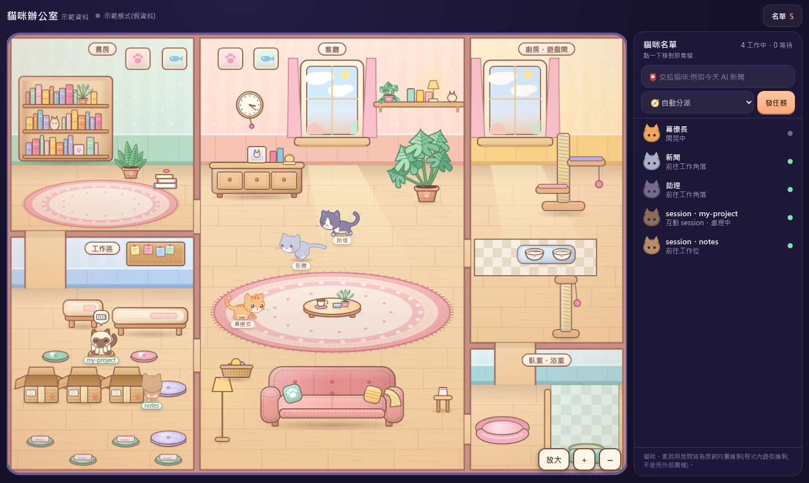
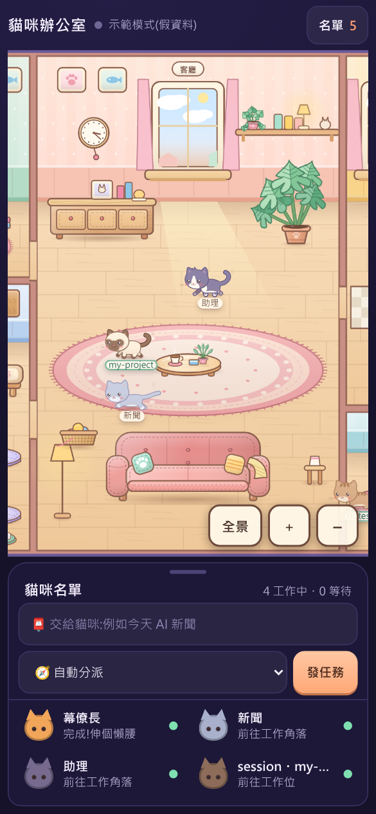

# Cat Office Fleet

*A pixel-cozy dashboard for a small fleet of Claude Code bots, drawn as cats in a hand-drawn apartment.*

Send a task from the web page or the CLI. A haiku-powered **router (幕僚長)** picks the best bot from each bot's
role description. The bot runs in its own folder with its own tool whitelist, resumes its own conversation and
long-term memory, and its cat in the apartment shows what it is doing (thinking, searching, reading, writing,
waiting, done, error). Click a cat to read the conversation and send follow-ups. Unread badges tell you which
bot finished something.

Everything runs on **your Claude Code subscription** through `claude -p`. **No `ANTHROPIC_API_KEY` is used**, and the
server only listens on `127.0.0.1`.





Add `?demo=1` to the URL (`http://127.0.0.1:8930/?demo=1`) to see the scripted demo without running any task.
`?coats=1` shows all 29 coats.

The UI text is Traditional Chinese (zh-TW); bot files and this README are English first, 繁體中文 below.

## Requirements

- Linux, WSL or macOS (macOS: process-tree cleanup on cancel is best-effort, and the optional session cats need `/proc`, so they are Linux/WSL only)
- Python 3.10+
- [Claude Code CLI](https://docs.claude.com/en/docs/claude-code) installed and **logged in with a subscription** (`claude` works in your terminal)
- A modern browser

## Install

```bash
git clone https://github.com/smallkill/cat-office-fleet.git cat-office-fleet && cd cat-office-fleet
python3 -m venv .venv && .venv/bin/pip install -r requirements.txt
./fleet.sh start        # -> http://127.0.0.1:8930
```

Stop / inspect: `./fleet.sh stop | status | logs`. The page token changes at every start; just reload the page.

## Use

```bash
./fleet task "Summarise today's AI news"          # router picks the bot, returns immediately
./fleet task "Explain DNS in 3 lines" assistant   # pick the bot yourself
./fleet ask  "Reply with OK" news                 # synchronous: waits, prints only the answer on stdout
echo "task text" | ./fleet ask -                  # task text from stdin; bot optional
./fleet bots | ./fleet tasks 5
./fleet rotate assistant                          # wrap up (tidy memory) and start a fresh conversation
./fleet reset assistant [--memory]                # hard reset (no wrap-up)
```

`ask` exit codes: 0 ok, 1 task error, 2 could not route, 3 timeout (task is cancelled), 4 cancelled / Ctrl-C.

## Configuration

Environment variables, or a `.env` file in the project root (copy `.env.example`; real env vars win):

| Variable | Default | Meaning |
|---|---|---|
| `FLEET_PORT` | `8930` | HTTP port |
| `FLEET_HOST` | `127.0.0.1` | `127.0.0.1` or `localhost` only; anything else (including `::1`) is refused at startup |
| `FLEET_DATA_DIR` | `./data` | SQLite database location |
| `FLEET_CACHE_DIR` | `./.cache` | token, prompt files, logs, memory backups |
| `FLEET_CTX_LIMIT` | `150000` | rotate a bot's conversation above this many context tokens |
| `FLEET_ROUTER_MODEL` | `haiku` | router model |
| `FLEET_SESSIONS` | off | `1` = show your interactive Claude Code sessions as extra cats (see below) |
| `TELEGRAM_BOT_TOKEN`, `TELEGRAM_CHAT_ID` | unset | both set = Telegram push when a task finishes |
| `FLEET_TG_NOTIFY` | on | `0` = switch the push off |

### Optional: Telegram completion push

If both `TELEGRAM_BOT_TOKEN` and `TELEGRAM_CHAT_ID` are set, tasks submitted from the web page or `./fleet task`
send a short plain-text summary through the Telegram Bot API when they finish (done or error). It is sent
asynchronously with a 10 s timeout and can never crash or block a worker; failures are only logged (the token is
scrubbed). `./fleet ask` and system tasks never notify. Without the two variables nothing is ever sent.

### Optional: session cats

With `FLEET_SESSIONS=1` the server reads **local metadata only** of your running interactive Claude Code sessions
(`~/.claude/sessions/*.json`, and the tail of the matching transcript for the last tool name and today's token count)
and shows each one as an extra cat. It is read-only, nothing is sent anywhere, and it is off by default.

## Adding a bot

1. `mkdir bots/foo`, write `bots/foo/BOT.md` (copy `bots/news/BOT.md` or `bots/assistant/BOT.md`):

   ```markdown
   ---
   name: Foo Bot
   emoji: "🧩"
   builtin: WebSearch, WebFetch
   allow: WebSearch, WebFetch
   add_dirs:
   memory: false
   ---
   ## Role (the router dispatches based on this section)
   One paragraph: what this bot is responsible for. The router picks bots by this text, so be specific.

   ## Rules
   - ...
   ```
2. Copy `bots/news/.claude/settings.json` to `bots/foo/.claude/settings.json` (deny list).
3. `./fleet.sh stop && ./fleet.sh start`. The new cat appears.

A bot that reads files or runs a script: see [docs/bot-template.md](docs/bot-template.md). Shipped examples:
`router` (required, haiku, no tools), `news` (web search), `assistant` (general helper, web tools, memory).
AI coding agents working in this repo should read [AGENTS.md](AGENTS.md).

## Security model

- **Two tool layers.** `builtin:` becomes `--tools` (the model cannot even see other tools); `allow:` becomes
  `--allowedTools` (no prompt). `--permission-mode dontAsk` denies everything else.
- **File access.** No bare `Read/Grep/Glob` in `allow`. Reads are limited to the bot's own folder and `add_dirs`.
- **Bash.** Only exact full command strings are allowed; compound-command deny rules (`&&`, `$(...)`, backticks) are in each bot's `settings.json`.
- **Writes.** Only bots with `memory: true` may Edit, and only their own `memory.md`.
- **Clean environment.** `ANTHROPIC_API_KEY` and other API / cloud-provider variables are stripped from every child process; your global CLAUDE.md and auto-memory are not loaded; `--setting-sources project` ignores your user-level settings and hooks.
- **Local API.** Random token regenerated at each start (`.cache/token`, mode 0600; access log off so it never reaches a log), Host and Origin allow-lists (DNS rebinding), JSON-only POST, loopback only. There is no login system: do not expose the port. Any local process or user on the machine can fetch the token from `GET /`, so this is meant for single-user machines.
- **Web access.** The example bots' deny lists block `WebFetch` to loopback addresses so a bot cannot call the local API.
- **Memory poisoning.** A bot with `memory: true` that also reads web pages can be tricked by page content into writing bad notes to its `memory.md`. Memory is backed up before every wrap-up (`.cache/memory-backup/`); check it now and then, and use `./fleet reset <bot> --memory` to clear it.
- **Prompts** are written to 0600 files, not passed in `argv`; task text goes through stdin.
- **Cancel / timeout** kills the whole process group and its descendants.

## Cost note

Every task is a real `claude -p` run and **counts against your Claude subscription usage limits** (5-hour / weekly).
The router is one small haiku call per auto-dispatched task. Each bot keeps a conversation (`--resume`), so context
grows until it is wrapped up and rotated (150k tokens or 7 days). The dollar figures in the UI are only reference values; a subscription does not bill per token.

## Architecture (short)

```
browser (SSE) ─┐
CLI / form ─POST /api/tasks─> fleetapp/main.py (FastAPI)
   1. router: claude -p --model haiku --tools ""  -> {"bot","reason"}
   2. one asyncio queue per bot (one task at a time)
   3. runner: claude -p --output-format stream-json --resume <session> --tools ... --allowedTools ... (cwd = bots/<id>/)
   4. stream-json -> events -> SQLite (data/fleet.db) + SSE
```

Known limits: tasks in flight when the server restarts are marked interrupted; the router picks exactly one bot and does not split tasks; no login.

## License

[PolyForm Noncommercial 1.0.0](LICENSE). Personal, hobby, research and other noncommercial use is free.
**Commercial use requires permission: contact smallkill via GitHub.**

---

# 繁體中文

**貓咪辦公室車隊**:用手繪貓咪公寓當儀表板的多 agent 小車隊。網頁或 CLI 送出任務 → 🧭 幕僚長(haiku)依各 Bot 的「職責」描述挑人 →
專屬 Bot 在自己的資料夾、自己的工具白名單下執行,延續自己的對話與長期記憶 → 公寓裡的貓咪即時顯示它在思考、搜尋、讀檔、寫檔、等待、完成或出錯。
點貓可看對話並追加任務,未讀徽章告訴你誰做完了。

全程走 **Claude Code 訂閱額度**(`claude -p`),**不使用 `ANTHROPIC_API_KEY`**,只綁 `127.0.0.1`。介面為繁體中文;網址加 `?demo=1` 看示範,`?coats=1` 看 29 種毛色。

## 需求

Linux / WSL / macOS、Python 3.10+、已用**訂閱帳號登入**的 Claude Code CLI。

## 安裝與啟動

```bash
python3 -m venv .venv && .venv/bin/pip install -r requirements.txt
./fleet.sh start        # http://127.0.0.1:8930   (停止:./fleet.sh stop;狀態/日誌:status / logs)
./fleet task "今天 AI 有什麼新聞"            # 自動分派
./fleet task "三行解釋 DNS" assistant        # 手動指定 Bot
./fleet ask "Reply with OK" news            # 同步等答案,只把答案印到 stdout
```

設定用環境變數或專案根目錄的 `.env`(範本 `.env.example`):`FLEET_PORT`、`FLEET_DATA_DIR`、`FLEET_CACHE_DIR`、`FLEET_CTX_LIMIT`、`FLEET_SESSIONS`、
`TELEGRAM_BOT_TOKEN` + `TELEGRAM_CHAT_ID`(兩者都設才會在任務完成時推 Telegram 純文字摘要;`./fleet ask` 不推)。`FLEET_HOST` 只接受 loopback。

## 新增 Bot

建 `bots/<id>/BOT.md`(front matter:`name / emoji / builtin / allow / add_dirs / memory`,內文「## Role」或「## 職責」段給幕僚長挑人用),
把 `bots/news/.claude/settings.json` 複製進 `bots/<id>/.claude/`,重啟服務即可。要讀檔或跑指令的 Bot 見 [docs/bot-template.md](docs/bot-template.md)。

## 安全設計

`builtin` 決定模型看得到哪些內建工具、`allow` 決定免詢問放行什麼,其餘一律拒絕(`dontAsk`);allow 不放裸 `Read/Bash`,Bash 只放完整指令;
只有 `memory: true` 的 Bot 能改自己的 `memory.md`;子行程環境剝除 API key、不載入你的全域設定;本機 API 有隨機 token、Host/Origin 白名單、只綁 127.0.0.1(沒有登入機制,請勿對外開放);
取消/逾時會殺整個行程群組。

## 費用

每個任務都是真的 `claude -p`,**會消耗你的 Claude 訂閱額度**(5 小時/每週上限)。介面上的美元數字只是參考值,訂閱不按 token 計費。

## 授權

[PolyForm Noncommercial 1.0.0](LICENSE):非商業使用免費;**商業使用請先取得許可,請透過 GitHub 聯絡 smallkill**。
